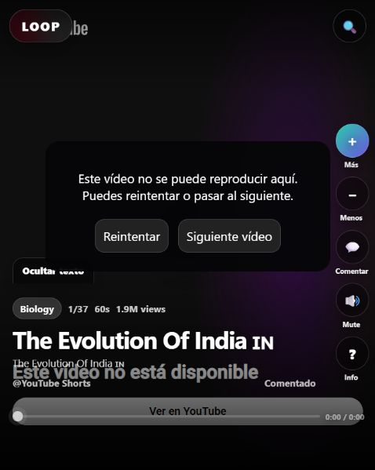
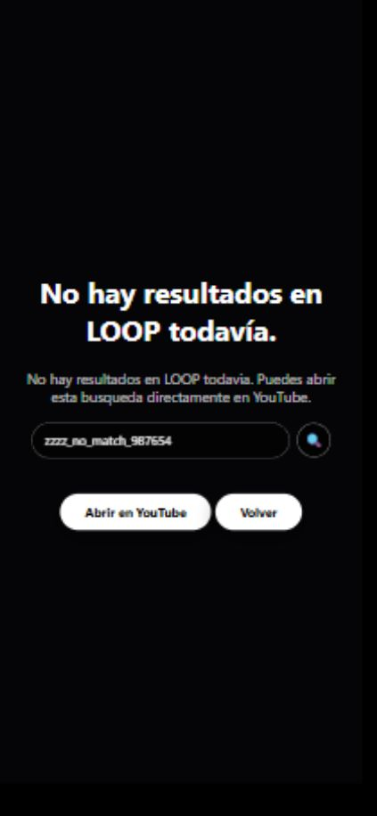

# LOOP — Correcciones de estabilización

14 de octubre de 2026. Entrega de estabilización para publicación directa en GitHub Pages. La validación en dispositivos reales sigue pendiente.

## Corregido

- Servidor limitado a loopback por defecto; lista explícita de recursos públicos; comprobación de ruta real; 404 para recursos inexistentes y archivos internos; 400 para rutas inválidas; soporte HEAD y rechazo de otros métodos.
- Desactivado `POST /api/seen-video` con respuesta 410. La aplicación no lo utilizaba y el endpoint podía reescribir archivos fuente sin controles. No se ha añadido una persistencia compartida.
- Búsqueda del servidor con URL HTTPS validada, límites de término, timeout y rechazo de redirecciones.
- Las búsquedas sin coincidencias ya no generan vídeos aleatorios. El respaldo local conserva la categoría original e identifica su origen.
- Las respuestas de búsqueda y paginación verifican consulta, pantalla y generación antes de modificar resultados o estados de carga. Volver al inicio o elegir categoría invalida las respuestas pendientes.
- Atajos excluidos de campos editables, botones, enlaces y diálogo de comentarios. Los comentarios se guardan para el vídeo seleccionado al abrir el diálogo.
- Feedback por `video_id` con migración de registros v3 a v4. La migración mantiene los registros antiguos sin borrarlos y combina comentarios y votos; prevalecen los valores más recientes según su fecha.
- Lecturas locales tolerantes a datos malformados y escrituras protegidas. Si guardar falla, la aplicación conserva el funcionamiento de la sesión y comunica la limitación.
- Recuperación al arrancar de vídeos y categorías guardados localmente. El catálogo local de vistos se limita a los últimos 500 vídeos almacenados; el catálogo incluido sigue disponible.
- Recuperación del reproductor ante script bloqueado, timeout o error de embed; botones para reintentar o saltar. Los callbacks de reproductores destruidos se ignoran.
- Exclusión de resultados remotos con identificadores inválidos o duración conocida superior a 180 segundos. Una duración ausente no certifica que sea un vídeo corto.
- Caché v8 con URLs iguales a las del HTML, prioridad de red y respaldo offline por recurso. APIs excluidas; HTML de respaldo solo para navegación; errores HTTP no cacheados. Los nombres de caché distinguen el ámbito de la aplicación y solo eliminan versiones del mismo ámbito. Las cachés antiguas genéricas se conservan sin usarse para evitar borrar recursos de otra aplicación.
- Etiquetas accesibles, foco visible, mensajes de estado y paneles cerrados fuera del foco mediante `inert`. Los campos interpolados adicionales se escapan antes de generar HTML.

## Validación

`node scripts/test-regressions.mjs` ejecuta 25 comprobaciones de regresión con respuestas de búsqueda simuladas y un servidor HTTP temporal. No depende de los proveedores externos ni modifica el catálogo. Un fallo termina con código distinto de cero.

Se ha comprobado en el navegador integrado la bienvenida, selección de categoría, apertura y escritura de comentarios con flechas, guardado para el mismo vídeo y la recuperación visible ante un vídeo no disponible. Una búsqueda real sin coincidencias mostró el estado vacío correcto. No se observaron avisos ni errores en los registros del navegador consultados antes de probar la búsqueda externa. También se ha inspeccionado una vista de 390 × 844; esta emulación no sustituye pruebas en un teléfono real.

## Prioridades pendientes para completar la aplicación

1. Validar instalación, actualización desde la versión antigua y arranque offline en navegadores reales; verificar en Android/iOS y revisar vídeos disponibles y no disponibles.
2. Verificar disponibilidad de los proveedores externos, duración y permisos de embed. La paginación oficial de YouTube y la estrategia final de proveedores siguen pendientes; las solicitudes invalidadas pueden continuar en red hasta su timeout, pero no aplican resultados.
3. Definir efecto de Más/Menos sobre las recomendaciones. Esta fase corrige su persistencia; no incorpora un algoritmo nuevo.
4. Definir aprobación educativa, fiabilidad de fuentes, tratamiento de puntuaciones y vídeos asociados a múltiples categorías; versionar la generación del catálogo desde CSV.
5. Decidir si se necesita almacenamiento compartido, sesiones o cuentas y elegir despliegue según esas necesidades.
6. Mejorar accesibilidad y adaptación después de pruebas reales, separar módulos y añadir validación automática en GitHub.
7. Actualizar las decisiones históricas de la documentación viva y validar el producto con usuarios antes de ampliar funciones.

La revisión de fase 1 y su JSON de resultados se conservan como diagnóstico histórico, no como descripción del estado posterior a estas correcciones.
